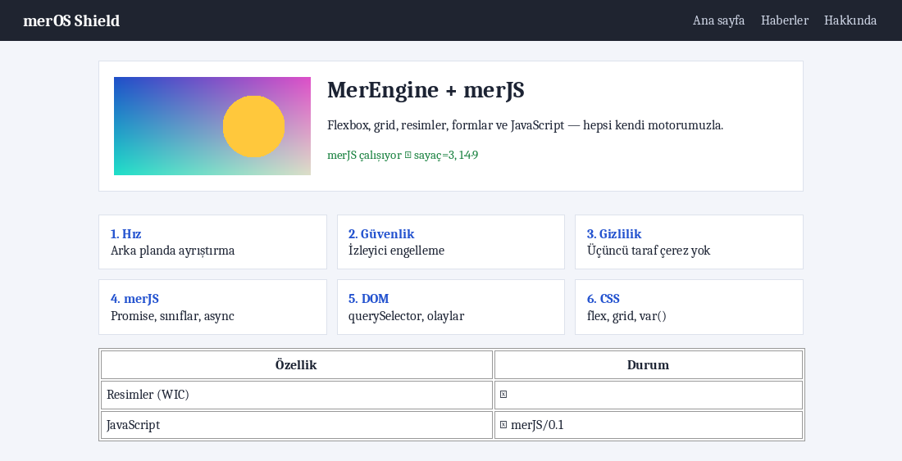

# merOS Shield — Custom-Engine Web Browser

**merOS Shield** is a high-performance, security-focused web browser for Windows, built from the ground up with its own proprietary rendering engine (**MerEngine**) and JavaScript engine (**merJS**). It does **not** rely on Chromium, WebView2, Trident, Gecko, V8, or any third-party browser runtime.



---

## Building (Visual Studio 2019)

1. Double-click `merOSShield.sln`.
2. Select **Release** and **x64** from the toolbar.
3. Right-click the `merOSShield` project → **Set as Startup Project**.
4. Press **F5** (or Build Solution).

**Build Artifact:** `bin\x64\Release\merOSShield.exe` (statically-linked CRT, single standalone executable).  
Zero third-party dependencies or NuGet packages required; MSVC v142 + Windows 10 SDK (10.0.19041.0 or newer) is all you need.

**Running Test Suites:**
- `JsTests` — Comprehensive test suite for **merJS**, DOM APIs, network polyfills, TypedArrays, Intl, and i18n.
- `EngineTests` — Regression test suite for HTML parser, CSS cascade/selectors, and layout engine.

---

## Keyboard Shortcuts & CLI

| Shortcut | Action |
|---|---|
| **Ctrl + L** / **F6** / **Alt + D** | Focus address bar |
| **F5** / **Ctrl + R** | Reload current page |
| **F12** / **Ctrl + Shift + J** | Toggle developer JS console |
| **Ctrl + Shift + S** | Save full-page screenshot (PNG saved to Pictures) |
| **Alt + ← / →** | Navigate Back / Forward |
| **Alt + Home** | Go to Home (`about:home`) |
| **Ctrl + Plus / Minus / 0** | Zoom In / Out / Reset (100%) |
| **Toolbar [JS] button** | Toggle JavaScript execution on/off |

**Headless CLI Mode (Automation / Testing):**
```cmd
merOSShield.exe --snapshot snapshot.png https://example.com
```
Loads the specified webpage, captures a high-resolution screenshot to `snapshot.png`, and cleanly exits.

---

## Architecture Overview

```
URL ──► [Network] WinHTTP + Windows SChannel (HTTP/2, gzip, TLS 1.3) ──► Background Thread
           │
           ▼
        [HTML Parser] ──► DOM Tree
           │       ├─ CSS Files ┐ Parallel background downloads (Trackers blocked)
           │       └─ Scripts   ┘
           ▼
        [merJS Engine] Document-order execution (ES Modules & Classic Scripts) ──► Background
           ▼
        [Style Resolver] Cascade, inheritance, var(), @media queries ──► Background
           ▼
        [Layout Engine] Block, inline, list, table, flexbox, grid, images, forms ──► UI
           ▼
        [Renderer] Direct2D + DirectWrite (GPU-accelerated), WIC images, WMF video
           ▲
        Event Loop: Mouse/keyboard events, setTimeout/setInterval, Promises,
        dynamic <script> injection, image & CSS loading ──► Throttled restyle (~20 fps)
```

### Source File Map

| Path | Purpose |
|---|---|
| `src/html.cpp`, `dom.*` | Spec-compliant HTML parser, DOM tree, node manipulation helpers |
| `src/css.*`, `style.*` | CSS lexer/parser, selector matching, cascade and style computation |
| `src/layout.*` | Platform-independent layout engine (Block, Inline, Flex, Grid, Tables) |
| `src/js/` | **merJS**: Lexer, AST parser, bytecode/tree interpreter, mark-and-sweep GC, DOM bindings |
| `src/js/js_intl.*` | ECMA-402 Internationalization (`Intl`) engine backed by Windows NLS |
| `src/video_decoder.*` | Windows Media Foundation (WMF) hardware/software video decoding pipeline |
| `src/i18n.*` | Centralized browser localization (English default, Turkish supported) |
| `src/view.*` | DirectWrite font formatting, Direct2D GPU rendering, scrolling, hit testing |
| `src/images.*` | Windows Imaging Component (WIC) asynchronous image decoding & cache |
| `src/net.*`, `blocklist.*` | WinHTTP network client, TLS 1.3, ad/tracker blocker |
| `src/main.cpp` | Win32 application window, navigation, JS event loop, forms, security policies |

---

## merJS — JavaScript & Web Standards Engine

merJS is a custom AST-walking interpreter equipped with an exact mark-and-sweep garbage collector, full GC root registration (`HostRoot`), and strict memory limits.

### Language Specifications
- **Modern ECMAScript (ES2020+):** `let`/`const`, arrow functions, classes (`extends`, `super`, static/instance fields), tagged template literals, destructuring, spread/rest, default parameters, optional chaining (`?.`), nullish coalescing (`??`), logical assignment (`??=`), `async`/`await`, generators, `for…of`, labelled loops, property getters/setters.
- **Standard Builtins:** `Object`, `Function` (`bind`/`call`/`apply`, dynamic compilation), `Array` (methods through ES2023), `String`, `Number`, `Boolean`, `Symbol`, `Math`, `JSON`, `Date`, `Map`/`Set`/`WeakMap`/`WeakSet`, `Promise` (`all`/`allSettled`/`race`/`any`/`finally`), `Reflect`, URI encoding, base64, `eval`.
- **Typed Arrays & Buffers:** `ArrayBuffer`, `Uint8Array`, `Uint16Array`, `DataView` with complete byte manipulation capabilities.
- **Text Encoding:** `TextEncoder` and `TextDecoder` (UTF-8, byte order mark (BOM) handling, surrogate pairs).
- **Network APIs:** Standard `fetch()` with Promise support, `XMLHttpRequest`, `Headers`, `Request`, and `Response`.
- **ECMAScript Modules:** Native `<script type="module">`, static `import`/`export`, dynamic `import()`, and `import.meta.url`.
- **Media Source Extensions (MSE):** `MediaSource`, `SourceBuffer` (chunk appending for streaming protocols like DASH), and `URL.createObjectURL()`.
- **Internationalization (Intl / ECMA-402):** `Intl.DateTimeFormat`, `Intl.NumberFormat`, `Intl.Collator`, `Intl.PluralRules`, `Intl.RelativeTimeFormat`, `Intl.ListFormat`, `Intl.DisplayNames`.
- **RegExp Unicode Support:** Unicode property escapes (`\p{L}`, `\p{Number}`, `\p{ASCII}`, etc.) and Unicode control characters.

### DOM & Browser APIs
- `document` (`querySelector`/`querySelectorAll`, `getElementById`, `createElement`, `write`, `cookie` getter/setter).
- `Element` (`innerHTML`, `textContent`, `classList`, `style`, `dataset`, `value`, events, `closest`, `matches`, `insertAdjacentHTML`).
- Event propagation (bubbling, `preventDefault`, `stopPropagation`, inline `onclick`, `addEventListener`).
- `location`, `history.pushState`, in-memory `localStorage`/`sessionStorage`, `URL`, `URLSearchParams`, `matchMedia`, `IntersectionObserver`.
- Dynamic `<script>` loading with automated dependency chaining.

---

## Video & Media Subsystem

merOS Shield includes a built-in media pipeline integrating **Windows Media Foundation (WMF)**:
- Hardware and software decoding for video codecs (H.264, VP9, MP4).
- Decompression into 32-bit BGRA video frames.
- Seamless bridge with MSE (`SourceBuffer.prototype.appendBuffer`) for chunk-based streaming platforms (e.g. YouTube DASH).
- Real-time video surface rendering via Direct2D hardware bitmaps.

---

## Internationalization & Localization (i18n)

merOS Shield features a bilingual localization system:
- **Default Language:** **English (`en-US`)** across all UI elements, status notifications, network headers, and DOM environments.
- **Supported Languages:** English (`en-US`) and Turkish (`tr-TR`).
- **HTTP Network Layer:** Automatically sends `Accept-Language: en-US,en;q=0.9,tr-TR;q=0.8,tr;q=0.7`.
- **DOM Navigator:** Configured with `navigator.language = 'en-US'` and `navigator.languages = ['en-US', 'en', 'tr-TR', 'tr']`.
- **One-Click Language Toggle:** Switch languages on the fly directly from the New Tab page (`about:home`) via `about:lang?tr` and `about:lang?en`.

---

## Security & Privacy Architecture

- **Strict HTTPS-Only:** Mandatory TLS 1.2 and TLS 1.3 via Windows SChannel. Invalid, self-signed, or expired certificates are never bypassed. Insecure HTTP→HTTPS upgrades occur automatically; plaintext HTTP requires explicit user consent.
- **Built-in Ad & Tracker Blocker:** Subresource requests to known advertising and telemetry domains are intercepted and dropped before network dispatch.
- **Privacy First:** No third-party cookies; zero disk persistence for cookies (session-only, wiped on exit). No HTTP `Referer` headers emitted; `Sec-GPC: 1` and `DNT: 1` sent by default.
- **Hardened JavaScript Sandbox:** Per-task execution step limits (prevents infinite loop freezing), recursion depth limits, C++ stack guard limits, and strict heap allocations. Popups and intrusive dialogs are blocked.
- **Anti-Phishing Defenses:** Deceptive credential tricks (`user@bank.com@evil.site`) are blocked; internationalized domain names (IDN) with lookalike characters are displayed in safe punycode.
- **Engine Safety Limits:** Maximum 250,000 DOM nodes, depth capped at 400, 24 MB document size limit, 6 MB script cap, and downsampling for oversized images.
- **OS-Level Process Mitigation:** Control Flow Guard (CFG), Intel CET Shadow Stack, High-Entropy ASLR, DEP, strict handle checks, mandatory System32 DLL signature enforcement, and custom font exploit mitigations.

---

## Roadmap

1. [x] Network APIs (`fetch`, `XMLHttpRequest`, `Headers`)
2. [x] Typed Arrays (`Uint8Array`, `ArrayBuffer`, `DataView`)
3. [x] Text encoding (`TextEncoder`, `TextDecoder`)
4. [x] ECMAScript Modules (`<script type="module">`, `import`/`export`)
5. [x] Media Source Extensions (MSE) & Video Codec Engine (Windows Media Foundation)
6. [x] Internationalization API (`Intl` / ECMA-402)
7. [x] English default language support & i18n subsystem
8. [ ] Tabbed browsing interface
9. [ ] In-page search (Ctrl + F), text selection, and clipboard copy
10. [ ] Additional CSS styling: `position: fixed`, `border-radius`, background gradients
11. [ ] Multi-process architecture: Sandboxed renderers running with restricted AppContainer tokens
